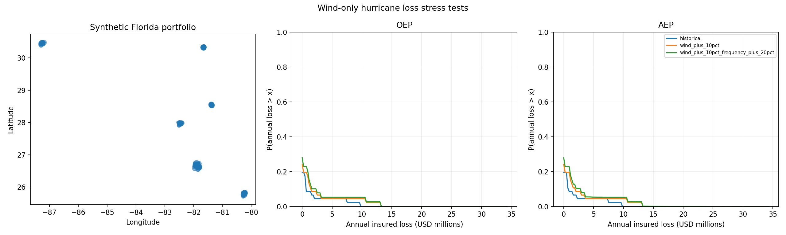

# Atlantic Hurricane Wind Loss Workflow

A reproducible Python workflow for exploring hurricane wind losses in a synthetic
Florida insurance portfolio. It combines NOAA Atlantic HURDAT2 tracks, an assumed
wind field, building vulnerability curves, and policy terms to compare historical
hazard with wind and frequency sensitivity scenarios.

**Research and education:** losses are conditional on assumed models and are not
calibrated to insurance claims. Station observations reveal substantial wind-model
errors, including in high winds. See [current results](docs/current_results.md)
for the evidence and limitations.

[Quick start](#quick-start) · [Results](#current-results) ·
[Methods](docs/model_methods.md) · [Validation](#observational-validation) ·
[Documentation](#documentation)

## Quick start

Use Python 3.10 or newer and run commands from the repository root. Python 3.12
is used in CI and the pinned dependency snapshot.

```bash
python -m venv .venv
source .venv/bin/activate
python -m pip install -r requirements.txt

# Download the pinned NOAA catalog if absent, then run the historical analysis.
python -m hurricane_risk --download --out outputs/historical-first-run
```

For the tested Python 3.12 dependency versions, install
[requirements-lock.txt](requirements-lock.txt) in place of `requirements.txt`.
The workflow runs directly from this directory; no package installation is needed.

The default catalog ends in 2024, and [config.json](config.json) selects
1980–2024. An existing local catalog is reused. If a download fails, obtain the
complete Atlantic [NOAA HURDAT2 catalog](https://www.nhc.noaa.gov/data/#hurdat)
and pass its path:

```bash
python -m hurricane_risk --tracks /path/to/hurdat2-atlantic.txt \
  --out outputs/historical-local-run
```

For an offline example with fabricated tracks:

```bash
python -m hurricane_risk --demo --out outputs/demo-first-run
```

Demo outputs are labeled **FABRICATED DEMO** and cannot be interpreted as
historical losses. Both examples use the configured portfolio and coastline.

Every run requires a **new output directory**. Completed runs are protected from
overwrites, and results are published only after successful completion. Change
`--out` when repeating any command below.

## What the workflow does

1. Selects storms that attained hurricane status during the configured seasons,
   retaining their recorded weakening and extratropical phases.
2. Interpolates tracks and computes property-level peak sustained winds using an
   assumed modified Rankine vortex.
3. Applies vulnerability curves and policy terms to calculate ground-up and
   insured event losses.
4. Aggregates all catalog years, including zero-loss years, and compares paired
   wind and frequency scenarios.
5. Saves annual average loss (AAL), occurrence and aggregate exceedance
   probabilities (OEP/AEP), uncertainty samples, figures, and provenance manifests.

Supply the complete Atlantic catalog: a selection of landfall storms biases
frequency and loss estimates. Input checks verify the catalog's date span but
cannot establish the completeness of a user-supplied subset.

## Current results

The default uses one-minute wind sampling and 300 synthetic Florida properties
constrained to at least 2 km inland in the generalized coastline dataset. The
1980–2024 run includes 310 hurricanes and $127,415,900 in replacement value.
Dollar values assume present-day USD and a fixed portfolio.

| Scenario | Insured AAL | Combined 5–95% range |
|---|---:|---:|
| Historical | $524,813 | $88,876–$1,058,338 |
| Wind +10% | $821,931 | $200,548–$1,566,439 |
| Wind +10%, frequency +20% | $986,317 | $240,658–$1,879,727 |

Ranges combine annual block resampling with assumed wind, storm-size, and
vulnerability uncertainty. They are conditional sensitivity ranges. The scenarios
are sensitivity tests; they do not constitute physical climate projections.



The [archived historical report](reports/current_default_historical/report.md)
contains the run summary. One-minute sampling meets the declared 1 m/s wind and
1% loss convergence criteria against a 15-second reference for the current
portfolio. Numerical convergence does not establish observational accuracy.
See the [resolution check](reports/land_only_resolution/report.md).

The earlier 30-minute configuration with original coordinates produced $416,633
in historical insured AAL. Reproduce it explicitly with
[the legacy configuration](examples/legacy_30min_config.json):

```bash
python -m hurricane_risk --config examples/legacy_30min_config.json \
  --out outputs/legacy-first-run
```

## Configuration and custom inputs

[config.json](config.json) controls the analysis years, random seed, portfolio
size, wind parameters, timestep, scenarios, and uncertainty settings.

| Setting | Default |
|---|---|
| Analysis period | 1980–2024, including zero-loss years |
| Synthetic portfolio | 300 properties; seed 7319; 2 km inland buffer |
| Wind sampling | 1 minute |
| Missing radius of maximum wind (RMW) | 35 km |
| Outer radial exponent / exposure factor | 0.6 / 0.85 |
| Resampled years / uncertainty replicates per mode | 20,000 / 200 |
| Return periods | 2, 5, 10, and 20 years |

To supply your own exposure and vulnerability curves:

```bash
python -m hurricane_risk --tracks data/hurdat2-1851-2024-040425.txt \
  --portfolio examples/portfolio.csv \
  --vulnerability examples/vulnerability.json \
  --out outputs/custom-first-run
```

Portfolio CSVs require unique `property_id` values and columns `lat`, `lon`,
`construction`, `replacement_value_usd`, `deductible_fraction`, and
`limit_fraction`. Construction types must match the vulnerability curves.
Custom portfolio coordinates are validated but are not automatically relocated.

Vulnerability JSON requires increasing `wind_nodes_ms`, monotone `damage_nodes`
by construction type, and source and wind-convention `metadata`. The model uses
**one-minute sustained wind at 10 m, in m/s**; curves defined for gusts or another
exposure require an explicit conversion before import. The bundled examples
illustrate the schema and retain the assumed vulnerability model.

## Outputs and reproducibility

Start with `report.md` and `summary.csv` in your chosen output directory.

| Artifacts | Contents |
|---|---|
| `portfolio.csv`, `assumed_vulnerability.csv` | Exposure, policy terms, and damage curves |
| `exposure_location_audit.csv` | Synthetic land-buffer relocations, when enabled |
| `hazard.npz` | Event × RMW alternative × property peak winds, with IDs |
| `event_losses.csv`, `property_aal.csv` | Event losses and historical property AAL |
| `historical_annual_losses.csv`, `historical_empirical_ep.csv` | Original annual losses and exact empirical exceedance probabilities |
| `simulated_annual_losses.csv`, `ep_curves.csv` | Resampled annual distributions and exceedance curves |
| `uncertainty_samples.csv`, `parameter_draws.csv` | Replicate metrics and shared parameter draws |
| `uncertainty_intervals.csv`, `scenario_comparison.csv` | Conditional ranges and paired scenario changes |
| `portfolio_and_ep.png`, `aal_uncertainty.png`, `vulnerability.png` | Portfolio, exceedance, uncertainty, and damage-curve plots |
| `manifest.json` | Configuration, input/output hashes, source hashes, and library versions |

Runs are seed-reproducible with the same inputs, code, configuration, and library
versions. Manifests record the evidence needed to compare runs. Older archived
experiments retain the provenance available when they were produced.

## Observational validation

Validation compares model winds with external station observations at documented
locations and times. Observations may also have informed NHC best tracks;
independence from track construction is not established.

| Study | Evidence and interpretation |
|---|---|
| [Original station peaks](reports/wind_validation/wind_validation_report.md) | 49 NWS METAR-section rows across Irma, Michael, and Ian; 22 eligible primary comparisons, all below hurricane force |
| [Reserved Valdosta events](reports/reserved_structural_study/report.md) | 260 supported good-QC reports across Debby and Milton; candidates fixed before inspecting the reserved series |
| [Laura confirmation](reports/laura_confirmation/report.md) | 71 eligible reports, including four at hurricane force; baseline RMSE 8.78 m/s overall and 16.34 m/s for those four reports |
| [Laura timing diagnostic](reports/laura_timing/report.md) | Dense model curves, center geometry, and all declared timing, position, and size perturbations |
| [Sally/Ida/Florence study](reports/next_collection_study_v2/report.md) | 1,182 QC report-time comparisons across six stations; zero hurricane-force samples; metadata supplement documents nominal instrument eligibility |
| [Observation inventory v3](reports/observation_inventory_v3/report.md) | 60 examined station/event pairs; original roles and missing coverage retained |

Local inland attenuation improves some overall scores but worsens Laura's
high-wind errors. Structural candidates remain experimental and disabled in the
default model. Gaps in station reporting leave event peaks incomplete.

The Sally/Ida/Florence collection has now been evaluated with all five frozen
candidates. Baseline station/storm-balanced RMSE is 4.96 m/s. An event-specific
NWS instrument statement resolves KMSY's initial height gap through a retained
metadata supplement, with observed winds and predictions unchanged. All candidates
remain experimental, and these six examined pairs
need a new held-out collection for future tuning. See
[the completed results and limitations](docs/next_collection_results.md).

To reproduce the original peak diagnostic or run a wind/loss benchmark:

```bash
python -m hurricane_risk.validation --out outputs/validation-first-run
python -m hurricane_risk.benchmark --out outputs/benchmark-first-run
```

The benchmark compares fixed wind variants at 30-, 5-, and 1-minute timesteps.
Each variant's finest timestep is its numerical reference. It retains all
candidate results and does not fit parameters or select a winner. See the
[benchmark findings](docs/benchmark_findings.md) and
[observation protocol](docs/observation_protocol.md) for detailed scoring rules.

## Model scope and limitations

The wind field, vulnerability curves, and policy assumptions are documented in
[model methods](docs/model_methods.md), including the wind equations, damage
nodes, annual-block frequency model, and uncertainty distributions.

- Synthetic locations represent approximate city clusters and are not verified
  insured parcels. Coastline classification uses generalized geography.
- RMW is missing for 88.2% of selected track observations. The 35 km fallback and
  idealized radial wind profile materially influence results.
- The default profile omits translation asymmetry, terrain, quadrant structure,
  and explicit local inland attenuation. Track interpolation cannot reconstruct
  unobserved storm evolution.
- Assumed damage curves and losses are not calibrated to claims. Surge, flood,
  contents, business interruption, demand surge, and reinsurance are excluded.
- Resampling 45 historical years adds no new extreme storms. Return periods
  cannot exceed the catalog length, and uncertainty ranges omit several sources
  of structural and exposure uncertainty.

## Development

Run the offline test suite from the repository root:

```bash
python -m unittest discover -s tests -v
```

GitHub Actions runs the same suite on Python 3.12 with pinned dependencies.
Coverage includes input validation, wind kernels, financial invariants,
reproducibility, output protection, observation QC, and registration checks.

| Directory | Purpose |
|---|---|
| `hurricane_risk/` | Modeling, validation, acquisition, and command-line modules |
| `examples/` | Custom input schemas, legacy configuration, and fixed candidates |
| `data/` | Catalog inputs, coastline data, station metadata, and evaluation locks |
| `scripts/` | Download, coastline preparation, and reporting helpers |
| `tests/` | Offline unit and integration tests |
| `docs/` | Methods, protocols, acquisition instructions, and current findings |
| `reports/` | Archived study results and provenance |
| `outputs/` | Local generated runs; ignored by Git |

Raw station downloads and HURDAT2 catalog text files are also ignored by Git.
Use `--download` for the pinned track catalog and follow the acquisition guide
for station inputs needed by additional studies.

## Documentation

- [Model methods and assumptions](docs/model_methods.md)
- [Current results and reproduction commands](docs/current_results.md)
- [Structural-model methods](docs/structural_models.md)
- [Observation protocol](docs/observation_protocol.md)
- [NOAA station data acquisition](docs/data_downloads.md)
- [Benchmark findings](docs/benchmark_findings.md)
- [Next validation milestone](docs/validation_next_steps.md)
- [Final review](reports/final_review/report.md)
