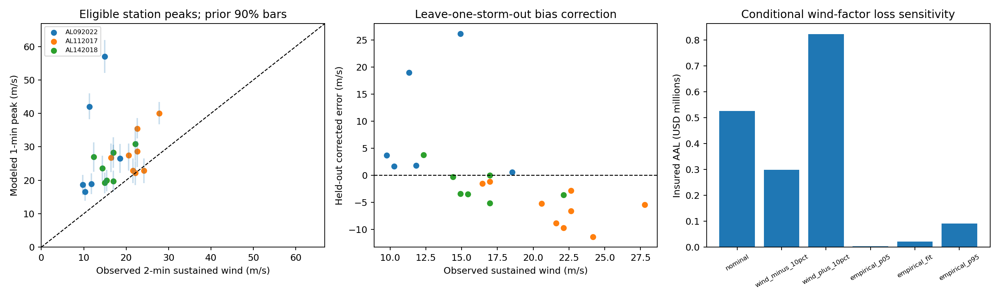
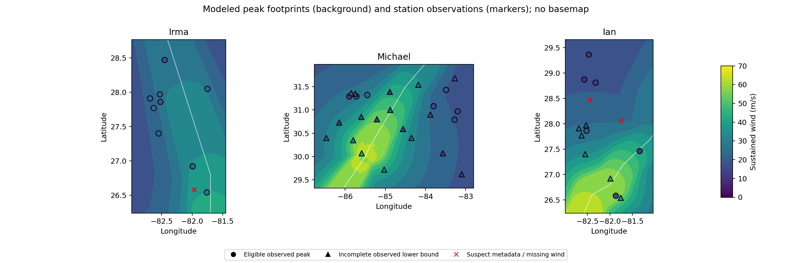

# Hurricane wind footprint validation

**Finding.** The unchanged Rankine model overpredicts eligible reported station peaks by 9.9 m/s on average (RMSE 13.7 m/s); its assumed 90% wind envelope covers 18% of observations. This external comparison reveals poor agreement but cannot certify an independently withheld wind field. The damaging hurricane-force core remains unvalidated.

## Data and comparability

All 49 unique METAR rows from three preselected NWS regional reports are retained: Irma (2017), Michael (2018), and Ian (2022). 22 station/event pairs have a finite sustained wind, no incomplete flag, and no flagged coordinate issue; only these enter primary scores. Selection uses report membership and quality flags, never the model residual. One duplicate KRSW entry in Irma is removed. All excluded rows and reasons remain in `station_pairs.csv`.

The reports specify 10-m, two-minute sustained winds in knots. The model predicts one-minute sustained winds; conversion to m/s is 0.514444. Following NOAA's duration guidance, the nominal comparison uses no 1-to-2-minute conversion. A hypothetical +5% adjustment of observations is reported separately as duration sensitivity, not a published conversion. Gusts, marine sites, and unknown-height non-METAR measurements are excluded. The same production wind engine and configured 0.85 exposure factor are used at station coordinates; regional UTC passage windows are listed in the provenance JSON. This evaluates peak amplitude at sparse locations, not a complete two-dimensional footprint, gust field, time evolution, or peak timing.

Eligible observed peaks span 9.8–27.8 m/s, all below the 64-kt hurricane threshold. The excluded and censored records contain the strongest measurements, so primary scores cannot establish performance where the vulnerability curves generate the most damage.

These observations were not used to select the original model coefficients. However, NHC may have used the same station data in HURDAT2 intensity analysis. Independence from best-track construction cannot be established; leave-one-storm-out fitting below only prevents leakage in the new multiplicative correction. All three storms are development diagnostics, not an untouched future test set.

## Performance

Errors are modeled minus observed wind, in m/s. Correlation measures association, not agreement. The open-exposure diagnostic divides the nominal wind by 0.85 without fitting, since airport exposure differs from insured properties. No model coefficient is changed by this validation.

| Sample / comparison | n | Bias | MAE | RMSE | Correlation |
|---|---:|---:|---:|---:|---:|
| pooled / nominal | 22 | 9.91 | 10.03 | 13.70 | 0.20 |
| pooled / open_exposure | 22 | 14.74 | 14.74 | 18.34 | 0.20 |
| AL092022 / nominal | 6 | 17.19 | 17.19 | 22.17 | 0.36 |
| AL092022 / open_exposure | 6 | 22.48 | 22.48 | 27.93 | 0.36 |
| AL112017 / nominal | 9 | 6.60 | 6.89 | 8.38 | 0.43 |
| AL112017 / open_exposure | 9 | 11.58 | 11.58 | 13.05 | 0.43 |
| AL142018 / nominal | 7 | 7.92 | 7.92 | 8.85 | 0.46 |
| AL142018 / open_exposure | 7 | 12.17 | 12.17 | 13.00 | 0.46 |
| pooled / observations_plus_5pct_duration_sensitivity | 22 | 9.03 | 9.36 | 13.14 | 0.20 |
| pooled / leave_one_storm_out_correction | 22 | -0.56 | 5.71 | 8.42 | -0.02 |
| pooled_without_Ian / nominal | 16 | 7.17 | 7.34 | 8.59 | 0.55 |

The `pooled_without_Ian` row is a report-quality sensitivity: it omits the entire Ian product because that preliminary summary documents widespread outages. This tests whether the result depends only on unflagged Ian rows; it is not an alternative primary sample selected by error size.

## Uncertainty and transfer test

Resampling whole storms with replacement (2,000 replicates, seeded) gives descriptive 5–95% ranges: bias 6.97 to 13.77 m/s, MAE 7.18 to 13.77, and RMSE 8.51 to 18.42. With only three storms there are very few independent blocks; these coarse ranges are not well-calibrated population confidence intervals. Repeated stations across storms create additional dependence that this storm-only bootstrap does not resolve.

The original assumed model envelope (RMW ×0.8/1.0/1.2 with weights .25/.50/.25, mean-one lognormal intensity with log SD .05) contains 18.2% of eligible observations in its nominal 90% interval. This is an ensemble of model-parameter assumptions, not a predictive interval including observation error or structural discrepancy. Its coverage diagnoses the adequacy of the prior wind uncertainty only; vulnerability uncertainty does not affect wind validation. The 0.25-minute time-step check changes eligible nominal peaks by at most 0.14 m/s.

A storm-balanced geometric-mean observed/model ratio is 0.622; its three-storm bootstrap factor range is 0.525–0.737. For each held-out storm, a factor fitted only to the other two storms is applied to its station predictions. Held-out pooled RMSE is 8.42 m/s versus nominal 13.70 m/s. A global correction cannot fix storm-size errors, asymmetry, station-specific exposure, or premature sensor failure. It remains diagnostic and is not installed as a calibrated model.

There are 24 finite, metadata-eligible incomplete station peaks, treated only as lower bounds: the model maximum falls below 0 of them. Model excess above an incomplete peak is not evidence of overprediction. Irma KFMY and Ian KVDF coordinates are flagged as suspect rather than silently corrected. Ian report remarks identify more incomplete stations than individual row flags. Unflagged rows can still have outages or report errors; the strongest near-eye winds are especially underrepresented in primary scores.

## Implications for insured losses

The configured 1980–2024 catalog, portfolio, vulnerability curves, deductibles and limits are rerun with global wind multipliers. Below, `empirical_p05/p95` are the wind-factor bootstrap endpoints and `empirical_fit` uses all eligible observations. These are conditional transport sensitivities, not validated loss corrections or total loss uncertainty bounds. Return losses use exact annual empirical CDFs here (the main workflow uses resampled years for scenario EPs).

| Wind sensitivity | Multiplier | Insured AAL | Change | 20-year OEP loss | 20-year AEP loss |
|---|---:|---:|---:|---:|---:|
| nominal | 1.000 | $524,813 | +0.0% | $2,021,636 | $2,154,429 |
| wind_minus_10pct | 0.900 | $299,193 | -43.0% | $887,320 | $887,320 |
| wind_plus_10pct | 1.100 | $821,931 | +56.6% | $3,162,457 | $3,542,673 |
| empirical_p05 | 0.525 | $3,192 | -99.4% | $0 | $0 |
| empirical_fit | 0.622 | $21,619 | -95.9% | $0 | $0 |
| empirical_p95 | 0.737 | $90,953 | -82.7% | $166,684 | $166,684 |

Nonlinear damage curves and deductibles amplify wind errors: a wind-bias adjustment must be passed through property damage and policy terms, not multiplied directly into AAL. The empirical factor combines wind structure, airport exposure and observation deficiencies; transporting it to residential properties over 45 years is unverified. The original loss model remains unchanged, and its 5% log-SD wind uncertainty assumption should not be interpreted as validated by this experiment.

## Limitations and next scientific step

The narrow sample spans only three regional landfalls and sparse airport locations, with many high-wind instruments censored. Preliminary reports are not full quality-controlled time series. Coordinate precision, one- versus two-minute duration, unresolved exposure, and sensor outages confound model errors. Fixed missing RMW, symmetric radial decay, no terrain and no explicit inland boundary-layer decay remain structural limitations. Wind verification cannot validate assumed damage curves or actual insurance recoveries.

The next step is a locked multi-event test set of quality-controlled station time series with instrument uptime, site exposure and best-track provenance, followed by size/asymmetry diagnostics. Obtain confirmation that those data were withheld from any model fitting and document possible use by NHC. Fit any richer wind model on separate events and evaluate it on the locked storms before replacing the existing loss model.

## Reproduce and audit

```bash
python -m hurricane_risk.validation
python -m unittest discover -s tests -v
```

Inputs, source URLs, QC decisions, observation and track hashes, configuration, software versions and code hashes are retained in `manifest.json`. Pairwise residuals, exclusions, leave-one-storm-out predictions, bootstrap replicates, metric tables and loss sensitivities are adjacent CSVs. `validation_diagnostics.png` visualizes nominal errors, held-out correction errors and conditional AAL sensitivity. `observed_footprints.png` overlays station peaks on modeled geographic footprints using one wind color scale. White lines are best tracks; the nominal sampling step is 1 minutes.





Sources:

- [NWS Tampa Bay PSHTBW, 2017-09-14 16:41 UTC](https://mesonet.agron.iastate.edu/wx/afos/p.php?e=201709141641&pil=PSHTBW) — A. METAR observations; all 10 unique rows, duplicate KRSW removed.
- [NWS Tallahassee PSH, 2018-10-27 01:40 UTC](https://www.weather.gov/tae/michael_psh) — A. METAR observations; all 25 rows; I on maximum sustained wind means incomplete.
- [NWS Tampa Bay PSHTBW, 2022-10-12 18:02 UTC](https://mesonet.agron.iastate.edu/wx/afos/p.php?e=202210121802&pil=PSHTBW) — A. METAR observations; all 14 rows; remarks override individual flags for RSW PGD SRQ SPG TPA GIF PIE.
- [NOAA sustained-wind duration guidance](https://www.aoml.noaa.gov/hrd/tcfaq/D4.html).
