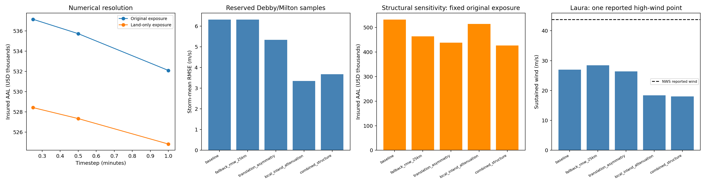

# Project completion and evidence

The five requested engineering areas now have implemented workflows and completed local evaluations.
Scientific scope is explicit: no claim of complete high-wind footprints or insured-loss calibration is made.

| Area | Delivered evidence |
|---|---|
| Observational benchmark | Downloaded QC time series, dated station history, documented height/duration, registered Debby/Milton tests, coverage and censoring audits. |
| Wind diagnosis and candidates | Inland-distance bins and coastline uncertainty; size, translation asymmetry, local inland attenuation and combined candidates; all results retained. |
| Numerical convergence | One-minute sampling meets 1 m/s and 1% criteria against 15 seconds for both original and land-only exposures. |
| Exposure/vulnerability | Validated custom inputs; land-only seeded exposure with financial terms preserved and all relocations recorded. |
| Workflow reliability | Protected atomic outputs, input/output/code hashes, dependency pins, offline integration tests and GitHub Actions. |

The original five storms remain development diagnostics. The separately reserved Debby and Milton windows
supply 260 good-QC samples supported by best-track times at one station. Model parameters were frozen
before those station-series winds or errors were examined. Independence from NHC best-track inputs is not established.

| Candidate | Reserved storm-mean bias (m/s) | Reserved storm-mean RMSE (m/s) |
|---|---:|---:|
| baseline | 5.64 | 6.32 |
| fallback_rmw_25km | 5.64 | 6.32 |
| translation_asymmetry | 4.48 | 5.34 |
| local_inland_attenuation | -1.24 | 3.35 |
| combined_structure | -1.67 | 3.68 |

These conditional, report-time scores do not select a winning model. All original structural parameters
remain fixed, and the optional candidates are disabled in the production baseline. Quantitative directional
site roughness and complete uptime are unresolved; censored sampled peaks are never promoted to complete peaks.

The current default historical AAL is **$524,813**. It uses one-minute sampling
and synthetic locations at least 2 km inside the generalized land mask. Values, construction and policy
terms are preserved. Of the original 300 points, 85 mapped offshore; the 2-km buffer relocates 169 points
including near-shore points, with a maximum displacement of 10.67 km. These remain synthetic locations, not verified parcels.

For the current exposure, one-minute AAL differs from the 15-second reference by 0.68%; maximum event/property
wind difference is 0.73 m/s. The finest tested timestep is still a numerical reference, not proof about unresolved storm evolution.
The legacy 30-minute configuration reproduces the prior historical tables exactly.

Linked reports: [current default](../current_default_historical/report.md),
[structural loss comparison](../structural_models/report.md),
[frozen reserved-event study](../reserved_structural_study/report.md),
[original exposure resolution](../subminute_convergence/report.md),
[land-only resolution](../land_only_resolution/report.md).

The additional Lake Charles/Laura high-wind confirmation is registered, with an importer and unchanged-model checks.
Its station-year download is a separate pending input; it is not represented as completed validation here.

The separate [NWS Laura reported-point check](../laura_reported_point_check/report.md) records 43.73 m/s
at the reported time, compared with 26.99 m/s for the baseline and 18.39 m/s for inland attenuation.
The latter improves the lower-wind reserved score but worsens this high-wind comparison. It is kept optional.
The NWS event peak is incomplete; this single source-reviewed point is not a full provider-QC time series or spatial validation.
