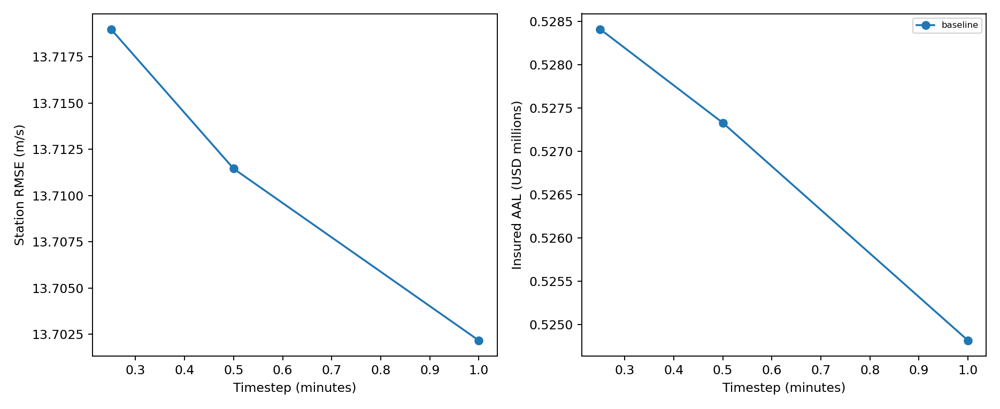

# Wind and loss benchmark

Predeclared sensitivity experiments; no parameters are fitted and no winning model is selected.
Current report peaks are development diagnostics. A test split records event separation,
but does not establish independence from NHC best-track construction or prior analyst use.

| Variant | Step (min) | Station RMSE (m/s) | Bias (m/s) | Insured AAL | AAL change vs baseline |
|---|---:|---:|---:|---:|---:|
| baseline | 0.25 | 13.72 | 9.92 | $528,411 | +0.00% |
| baseline | 0.5 | 13.71 | 9.91 | $527,329 | +0.00% |
| baseline | 1.0 | 13.70 | 9.91 | $524,813 | +0.00% |

Convergence thresholds: maximum property wind change ≤ 1 m/s and absolute
percentage loss-metric change ≤ 1% relative to the finest tested timestep.
A zero reference loss passes only if its absolute change is zero; percentage change is missing.
18 of 18 non-reference metric comparisons pass both thresholds.
These are user-set numerical criteria. The finest timestep is a reference, not proof of convergence.
Return losses use exact annual empirical quantiles, preserving zero years; no annual resampling noise is introduced.
Losses use the full configured hurricane catalog and fixed exposure/policy terms; station skill uses source windows.
Fallback-RMW variants change missing RMW only. Observed positive RMW is preserved.
Track-side and distance diagnostics are geometric. When a coastline is configured, signed coastal distances and inland bins are included.
Translation and local inland attenuation are declared structural sensitivities; they are not calibrated replacements.
The prior wind envelope remains an assumed parameter ensemble, not a calibrated predictive interval.
No claim validation, physical climate attribution, or high-wind validation follows from these comparisons.

