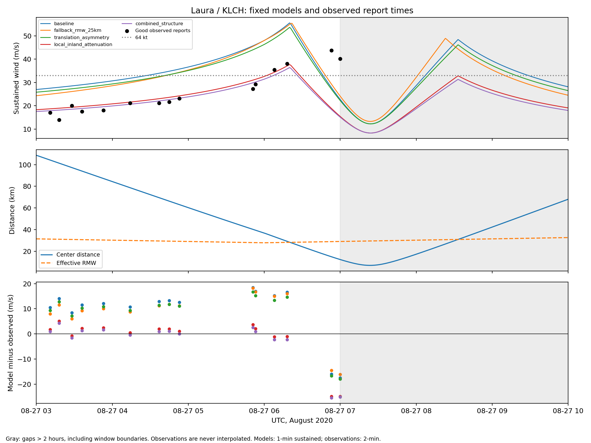
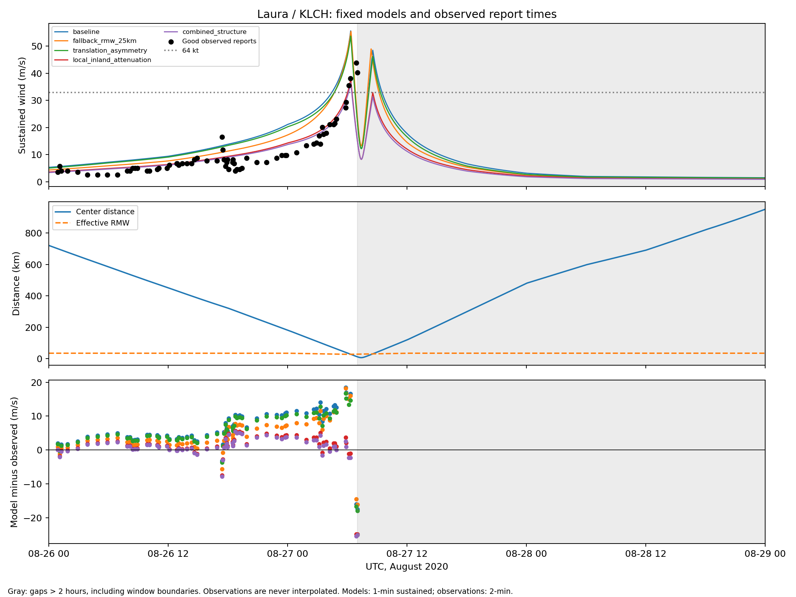

# Laura timing and geometry diagnostic

This is an exploratory diagnostic of already examined observations. All five registered candidate predictions reproduce the archived confirmation at eligible report times.
No parameter is fitted, no perturbation is selected, and production defaults and frozen model code remain unchanged.

Interpolated closest approach is 6.90 km at 2020-08-27 07:24:00+00:00. Effective RMW there is 29.46 km.
Track fixes missing RMW: 97.6%; the effective radius includes the declared fallback.
Observed sampled maximum is 43.80 m/s at 2020-08-27 06:53:00+00:00. Missing uptime means its timing is not a known complete-event peak time.

The baseline dense maximum is 55.60 m/s at 2020-08-27 06:20:00+00:00, with a signed offset of -33 minutes relative to the observed sampled maximum.

| UTC report | Observed (m/s) | Baseline (m/s) | Residual (m/s) | Center distance (km) | Distance/RMW |
|---|---:|---:|---:|---:|---:|
| 2020-08-27 06:08:00+00:00 | 35.50 | 50.71 | +15.21 | 33.37 | 1.19 |
| 2020-08-27 06:18:00+00:00 | 38.10 | 54.69 | +16.59 | 29.15 | 1.04 |
| 2020-08-27 06:53:00+00:00 | 43.80 | 27.84 | -15.96 | 14.88 | 0.52 |
| 2020-08-27 07:00:00+00:00 | 40.20 | 22.70 | -17.50 | 12.28 | 0.42 |

The sign change is consistent with a timing or geometry mismatch; this does not identify a cause. The idealized vortex also imposes an eyewall and calm-center structure.
Positive time shifts evaluate the model later than the report; east/north shifts move every original track fix by the stated small displacement.
RMW cases change the missing-value fallback only. All perturbations are one-factor exploratory sensitivities, not estimated uncertainty bounds or proposed corrections.
All sensitivities use the same 71 eligible reports; 0 reports lack common shifted-track support.

| Case | Reports | Overall RMSE (m/s) | Hurricane-force RMSE (m/s) |
|---|---:|---:|---:|
| baseline | 71 | 8.78 | 16.34 |
| time_-30min | 71 | 7.07 | 7.69 |
| time_-15min | 71 | 7.58 | 8.43 |
| time_+15min | 71 | 9.90 | 20.78 |
| time_+30min | 71 | 10.60 | 21.17 |
| east_-10km | 71 | 8.09 | 9.24 |
| east_+10km | 71 | 8.92 | 18.11 |
| north_-10km | 71 | 7.07 | 5.65 |
| north_+10km | 71 | 10.51 | 21.10 |
| fallback_rmw_25km | 71 | 7.14 | 15.40 |
| fallback_rmw_45km | 71 | 10.45 | 17.21 |

The diagnostic table retains the declared order; it must not be used to choose a correction on Laura.
Peak timing tables report the first occurrence and tie counts for dense model maxima and model maxima at actual eligible reports. Timing offsets are descriptive comparisons to a censored sampled peak.
One-minute curves interpolate best tracks; they do not reconstruct unobserved rapid changes. Wind averaging duration and unknown site exposure remain limitations.

