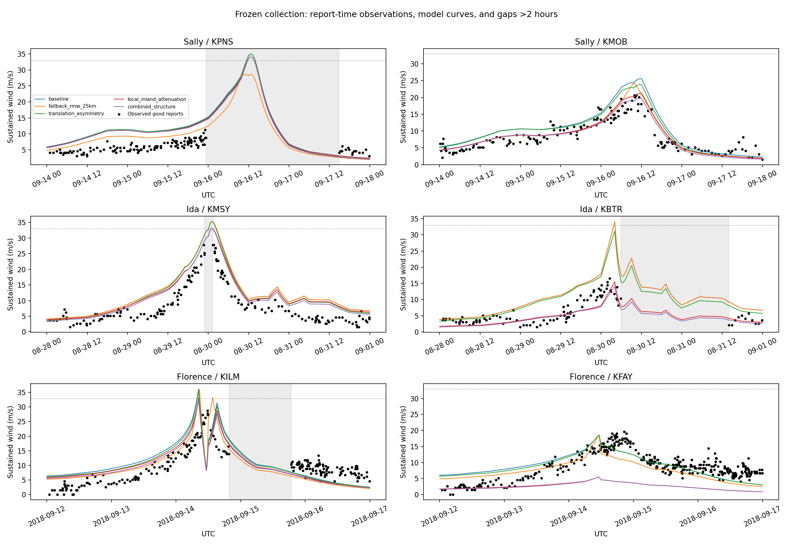

# Frozen multistation validation: Sally, Ida and Florence

All five candidates and the six station/event pairs were registered before their winds or residuals were inspected. A dated provider-ID amendment corrects Wilmington without changing its station or window.
No candidate is fitted, selected or promoted. These results are held out from this project’s model development, not necessarily independent of NHC best-track construction.
The registered primary metric weights stations equally within each storm, then storms equally. It is unavailable unless all planned pairs meet instrument/sample eligibility.
Available-case scores include nominal-instrument conditional comparisons and retain explicit station counts; they are not the complete registered primary metric.

| Candidate | Complete primary storms | Registered primary RMSE (m/s) | Available-case storm-balanced RMSE (m/s) | Reports | Hurricane-force reports |
|---|---:|---:|---:|---:|---:|
| baseline | 2/3 | unavailable | 4.96 | 1182 | 0 |
| fallback_rmw_25km | 2/3 | unavailable | 4.38 | 1182 | 0 |
| translation_asymmetry | 2/3 | unavailable | 4.61 | 1182 | 0 |
| local_inland_attenuation | 2/3 | unavailable | 4.39 | 1182 | 0 |
| combined_structure | 2/3 | unavailable | 4.27 | 1182 | 0 |

| Storm | Station | Primary eligible | Reports | High-wind reports | Baseline RMSE (m/s) | High-wind RMSE (m/s) | Failure |
|---|---|---|---:|---:|---:|---:|---|
| AL192020 | KPNS | True | 135 | 0 | 4.91 | nan |  |
| AL192020 | KMOB | True | 173 | 0 | 3.85 | nan |  |
| AL092021 | KMSY | False | 169 | 0 | 5.57 | nan |  |
| AL092021 | KBTR | True | 103 | 0 | 6.77 | nan |  |
| AL062018 | KILM | True | 236 | 0 | 5.66 | nan |  |
| AL062018 | KFAY | True | 366 | 0 | 3.02 | nan |  |

High-wind subsets use exactly 64 kt (32.924416 m/s). Absent subsets retain missing errors rather than zero. Report counts are not independent storm replicates.
Every event peak is censored: complete uptime is unverified. Peak magnitudes and timing offsets describe sampled observations, not continuously observed event maxima.
Coordinates use the applicable dated surface history. Nominal heights have station-specific source citations in station_metadata_audit.json; any site-continuity limitation excludes that pair from the primary metric.
Station roughness remains unknown; model one-minute and ASOS two-minute durations are retained without a fitted conversion.
See station_scores.csv for all candidates, paired changes, high-wind errors and peak timing; coverage.csv for gaps; qc_audit.csv for exclusions.

