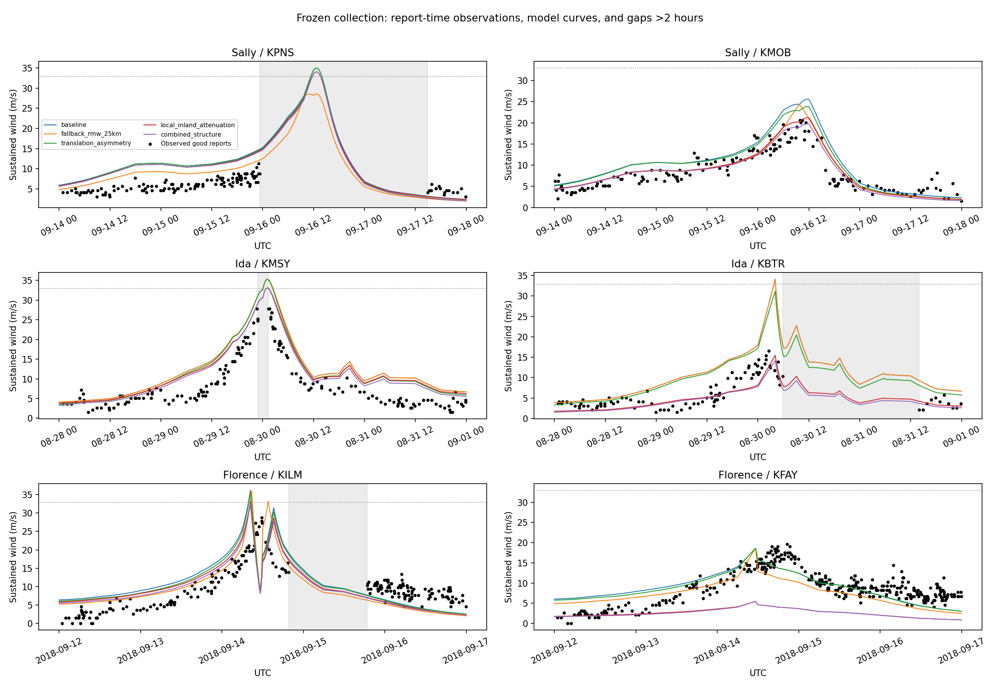

# Frozen multistation validation with documented metadata supplement

All six registered Sally/Ida/Florence pairs were evaluated with all five original candidates. The first frozen evaluation is retained under reports/next_collection_study_v1.
After that evaluation, the event-specific NWS Ida METAR report was found to document 10-m height and two-minute averaging for KMSY. This resolves the relocated-site eligibility gap.
[NWS event-specific instrument evidence](https://www.weather.gov/lch/2021Ida-PSHLIX). This metadata supplement was made after seeing the first scores; its timing is explicit in metadata_supplement.json.
Every observed wind, modeled value, QC decision, paired sample comparison, station and window is unchanged. Only metadata eligibility flags and the consequent primary summary availability change.

| Candidate | Complete primary storms | Registered station/storm-balanced RMSE (m/s) | Reports | Hurricane-force reports |
|---|---:|---:|---:|---:|
| baseline | 3/3 | 4.96 | 1182 | 0 |
| fallback_rmw_25km | 3/3 | 4.38 | 1182 | 0 |
| translation_asymmetry | 3/3 | 4.61 | 1182 | 0 |
| local_inland_attenuation | 3/3 | 4.39 | 1182 | 0 |
| combined_structure | 3/3 | 4.27 | 1182 | 0 |

The primary metric weights stations equally within each storm, then storms equally. All six pairs now have nominal instrument documentation; directional roughness and continuous uptime remain unknown.
No good-QC supported observation reaches 64 kt. This is lower-wind geographic evidence, not high-wind validation. All event peaks remain censored, including the NWS-marked incomplete KMSY peak.
No candidate is selected, fitted or promoted. The model one-minute and ASOS two-minute averaging durations remain explicit without a fitted conversion.
All station scores, high-wind missing subsets, paired changes, peak timing, exclusions and gaps are retained in the CSV files. Reports are not independent storm replicates.

