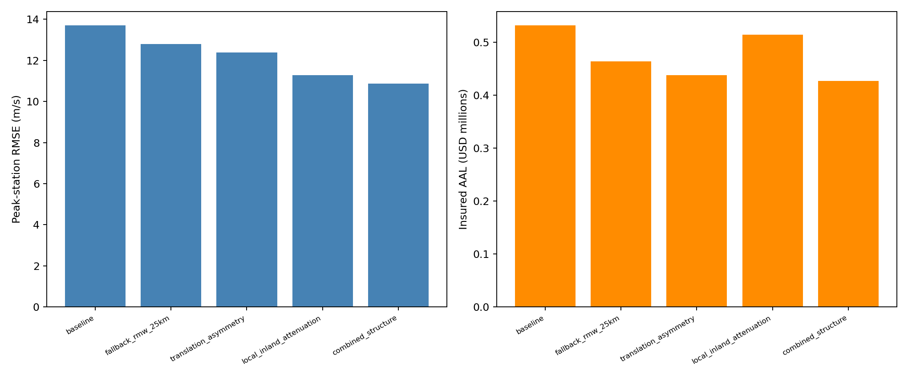

# Structural wind and insured-loss comparison

These batches use identical original synthetic exposure and the same one-minute wind resolution.
Every repeated baseline table was required to match exactly before combining results.
Baseline convergence against 15-second sampling is documented separately. No candidate is fitted or selected here.

| Candidate | Peak-station RMSE (m/s) | Bias (m/s) | Insured AAL | AAL change |
|---|---:|---:|---:|---:|
| baseline | 13.70 | 9.91 | $532,088 | +0.00% |
| fallback_rmw_25km | 12.80 | 7.17 | $464,011 | -12.79% |
| translation_asymmetry | 12.38 | 7.33 | $438,286 | -17.63% |
| local_inland_attenuation | 11.28 | 1.87 | $514,332 | -3.34% |
| combined_structure | 10.87 | -0.13 | $426,789 | -19.79% |

Peak scores use the original eligible primary observations. The separate frozen report-time study evaluates
new reserved events. Inland attenuation and translation asymmetry remain declared model assumptions.
The original exposure includes offshore synthetic coordinates; the land-only exposure and its numerical check
are documented separately so exposure relocation is not confounded with a hazard-model change.
No insured-claims calibration, physical climate attribution or complete high-wind footprint validation is asserted.

