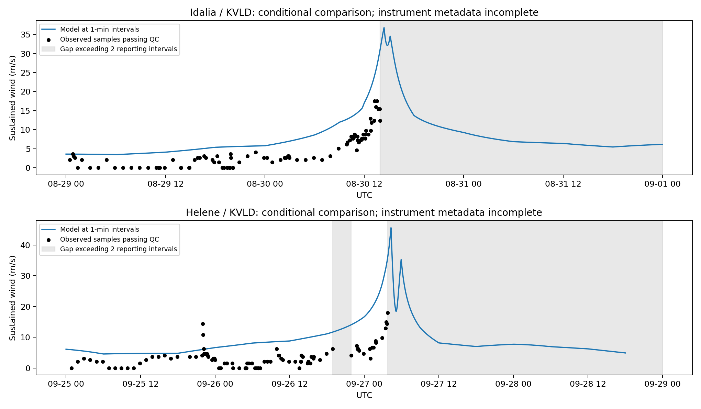

# Time-matched station wind diagnostics

Good provider quality flags permit a conditional sample comparison. They do not establish
station-specific instrument height, site exposure, continuous uptime or event-peak capture.
The model assumes local 10-m, one-minute winds and the configured uniform exposure factor;
the ASOS observations use the nominal two-minute convention. No duration or height correction is fitted.
All events in this run are development diagnostics; no independent test-skill claim is made.

| Storm | Station | Good samples | Bias (m/s) | RMSE (m/s) | Observed sampled peak | Model at report times | Model at 1-min intervals |
|---|---|---:|---:|---:|---:|---:|---:|
| AL102023 | KVLD | 89 | 5.40 | 6.24 | 17.50 | 30.75 | 36.76 |
| AL092024 | KVLD | 96 | 6.30 | 7.82 | 18.00 | 35.75 | 45.59 |

Wind peaks in the table are in m/s. Observed sampled peaks are lower bounds when coverage is incomplete.
A model maximum above a lower-bound observation is not evidence of peak overprediction.
Sample residuals are computed only at actual reports that pass QC, without interpolating observed winds
through outages. They are conditional diagnostics, not primary peak-validation scores.
Model values outside the best-track time span are missing; model windows and unsupported sample counts are saved.
Dense model curves evaluate the same interpolated-track Rankine equations at one-minute intervals.
They do not reconstruct unobserved intensity changes or certify convergence below one minute.
Coverage and metadata issues are retained in coverage.csv and performance.csv.

