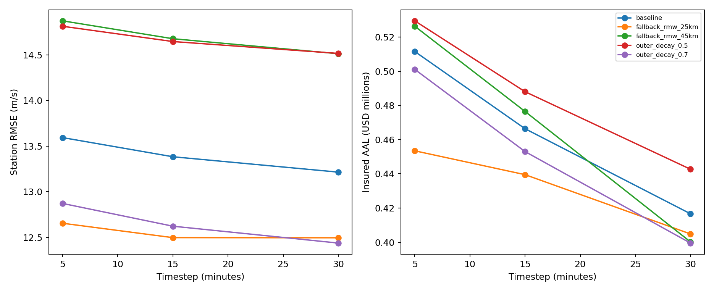

# Wind and loss benchmark

Predeclared sensitivity experiments; no parameters are fitted and no winning model is selected.
Current report peaks are development diagnostics. A test split records event separation,
but does not establish independence from NHC best-track construction or prior analyst use.

| Variant | Step (min) | Station RMSE (m/s) | Bias (m/s) | Insured AAL | AAL change vs baseline |
|---|---:|---:|---:|---:|---:|
| baseline | 5 | 13.59 | 9.85 | $511,514 | +0.00% |
| baseline | 15 | 13.38 | 9.69 | $466,359 | +0.00% |
| baseline | 30 | 13.22 | 9.46 | $416,633 | +0.00% |
| fallback_rmw_25km | 5 | 12.66 | 7.09 | $453,446 | -11.35% |
| fallback_rmw_25km | 15 | 12.50 | 7.00 | $439,501 | -5.76% |
| fallback_rmw_25km | 30 | 12.50 | 6.99 | $404,842 | -2.83% |
| fallback_rmw_45km | 5 | 14.87 | 12.02 | $526,290 | +2.89% |
| fallback_rmw_45km | 15 | 14.68 | 11.86 | $476,457 | +2.17% |
| fallback_rmw_45km | 30 | 14.51 | 11.65 | $400,191 | -3.95% |
| outer_decay_0.5 | 5 | 14.81 | 11.81 | $529,440 | +3.50% |
| outer_decay_0.5 | 15 | 14.65 | 11.68 | $488,011 | +4.64% |
| outer_decay_0.5 | 30 | 14.52 | 11.50 | $442,674 | +6.25% |
| outer_decay_0.7 | 5 | 12.87 | 8.24 | $501,061 | -2.04% |
| outer_decay_0.7 | 15 | 12.62 | 8.05 | $452,995 | -2.87% |
| outer_decay_0.7 | 30 | 12.44 | 7.81 | $399,499 | -4.11% |

Convergence thresholds: maximum property wind change ≤ 1 m/s and absolute
percentage loss-metric change ≤ 1% relative to the finest tested timestep.
A zero reference loss passes only if its absolute change is zero; percentage change is missing.
0 of 90 non-reference metric comparisons pass both thresholds.
These are user-set numerical criteria. The finest timestep is a reference, not proof of convergence.
Return losses use exact annual empirical quantiles, preserving zero years; no annual resampling noise is introduced.
Losses use the full configured hurricane catalog and fixed exposure/policy terms; station skill uses source windows.
Fallback-RMW variants change missing RMW only. Observed positive RMW is preserved.
Track-side and distance diagnostics are geometric. Inland distance is unavailable without an audited coastline.
The prior wind envelope remains an assumed parameter ensemble, not a calibrated predictive interval.
No claim validation, physical climate attribution, or high-wind validation follows from these comparisons.

